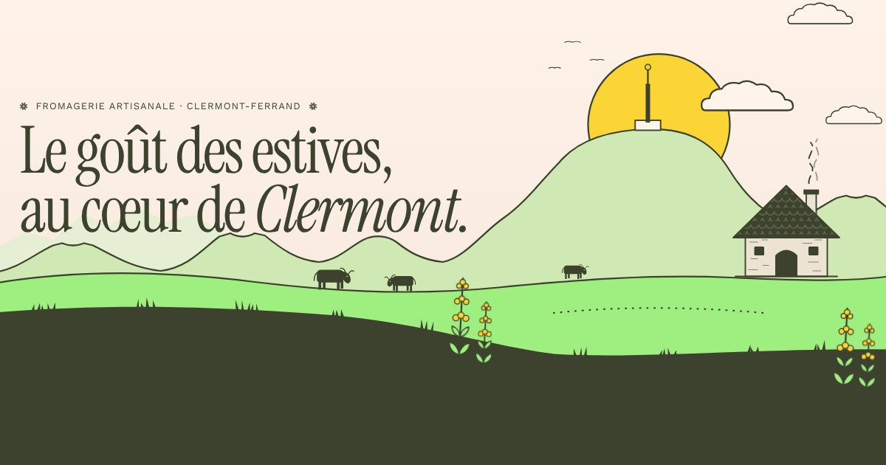

# Au Buron — fromagerie artisanale, Chamalières (Clermont-Ferrand)

Site vitrine de quatre pages, très animé, inspiré de l’univers éditorial de Graza : fonds crème, encre olive, bandeaux moutarde et vert prairie, grands titres serif condensés et texte « machine à écrire ».



## Les pages

| Page | Contenu |
|---|---|
| `index.html` | Accueil : toutes les sections décrites ci-dessous |
| `fromages.html` | La cave : 17 fromages illustrés, filtres par famille, fiche détaillée au clic (photo, description, goût, accords, prix au kilo) |
| `recettes.html` | 8 recettes avec photos, filtres, recette détaillée (quantités ajustables au nombre de personnes, étapes à cocher) |
| `commande.html` | Click & collect : plateau sur mesure, fromages à la coupe, soirée raclette / fondue / truffade / aligot, coffret cadeau ; panier, choix du créneau de retrait, envoi par e-mail |

Le passage d’une page à l’autre est animé par un rideau. La pastille « Ouvert / Fermé » en haut à droite ouvre le panneau des horaires.

## Ce que contient l’accueil

| Section | Effets |
|---|---|
| Préchargement | Meule qui tourne, compteur 0 → 100 %, rideau qui se lève |
| Hero (paysage de la chaîne des Puys) | Décor en couches qui monte au chargement, soleil levant derrière le Puy de Dôme, fumée, vaches, gentianes qui ondulent ; parallaxe à la souris et au défilement (les collines « avalent » le titre) |
| Bandeau défilant | Noms des fromages en continu ; la vitesse, le sens et l’inclinaison suivent le défilement |
| Manifeste | Les mots s’allument un à un au défilement, pastilles illustrées, badge tournant, compteurs animés |
| Nos fromages | Section épinglée à défilement horizontal, cartes qui changent de couleur et « s’entament » au survol ; fiche avec photo au clic |
| De l’estive au comptoir | Cadre collant dont la scène change à chaque étape (révélation circulaire) |
| Composez votre plateau | Calculateur : nombre de convives et occasion → quantité conseillée, sélection de fromages (nombre impair) et plateau dessiné en direct ; bouton qui ouvre la commande click & collect pré-remplie |
| Nuage de mots | Les verbes s’assemblent, suivent la souris, l’ovale se dessine autour de « Partager » |
| Accords | Lignes qui se remplissent au survol, carte du fromage qui suit le curseur |
| Recettes | Illustrations animées au survol (la tomme file, la poêle tourne…), lien vers la recette détaillée |
| Nous trouver | Statut **ouvert / fermé en direct** (heure de Paris), jour courant surligné, devanture dont la porte s’ouvre au survol |
| Pied de page | Silhouette de la chaîne des Puys, logotype géant qui monte lettre par lettre |

Partout : défilement fluide, curseur personnalisé avec libellés (« Goûter », « Miam », « Entrer »), boutons magnétiques, textes qui roulent au survol, titres révélés ligne par ligne, grain imprimé.

Les animations sont jouées sur tous les appareils, y compris quand l’ordinateur demande à réduire les animations (réglage fréquent sous Windows). Un bouton « Réduire les animations » dans le pied de page permet à chaque visiteur de les couper ; son choix est mémorisé. Le site reste entièrement lisible sans JavaScript.

## Voir le site en local

Aucune installation nécessaire, c’est un site statique :

```bash
python3 -m http.server 8000
# puis ouvrir http://localhost:8000
```

## Mettre en ligne

N’importe quel hébergement de fichiers statiques convient :

- **GitHub Pages** : *Settings → Pages → Deploy from a branch*, choisir la branche et le dossier racine.
- **Netlify** : glisser-déposer le dossier du projet sur [app.netlify.com/drop](https://app.netlify.com/drop).
- Ou tout hébergeur classique (OVH, o2switch…) en envoyant les fichiers par FTP.

## À personnaliser avant la mise en ligne

Les informations partagées par toutes les pages sont dans **`assets/js/data.js`** (source unique) :

- [ ] **E-mail** : `shop.email` vaut `contact@example.com` ; à remplacer, ainsi que les liens `mailto:` des pages HTML. C’est l’adresse qui reçoit les commandes.
- [ ] **Horaires** : `shop.hours` (0 = dimanche). Ils ont été relevés sur PagesJaunes ; à vérifier. Le statut « ouvert / fermé » et les créneaux de retrait en découlent. Le tableau de la section « Nous trouver » de l’accueil est aussi écrit en dur dans `index.html`.
- [ ] **Prix au kilo** : champ `price` de chaque fromage. Ce sont des **prix indicatifs** à remplacer par les vrais tarifs. Idem pour les à-côtés (`EXTRAS`) et le prix du fromage à raclette (`RACLETTE_PRICE`) dans `initOrder` (`assets/js/app.js`).
- [ ] **Fromages et recettes** : ajouter, retirer ou modifier des entrées dans `cheeses` et `recipes`. Les pages se mettent à jour seules.
- [ ] **Photos** : remplacer les photos d’illustration (`assets/photos/`, voir `CREDITS.md`) par vos propres photos, en gardant deux tailles : 1400 px (`nom.jpg`) et 640 px (`nom-s.jpg`).
- [ ] **En-tête et pied de page** : ils sont recopiés dans les quatre pages HTML ; une modification doit être faite dans chacune.
- [ ] **Image de partage** : dans `<head>`, remplacer `assets/img/og-image.jpg` par l’adresse complète une fois le site en ligne.
- [ ] **Mentions légales** : obligatoires pour un site professionnel en France (raison sociale, SIRET, hébergeur…).
- [ ] **Réseaux sociaux** : ajouter les liens Instagram / Facebook dans le pied de page si besoin.

## Structure

```
index.html              accueil (contenu + illustrations SVG)
fromages.html           la cave
recettes.html           les recettes
commande.html           click & collect
assets/css/style.css    styles, jetons de couleurs et de typographie
assets/js/data.js       boutique, horaires, fromages, recettes (source unique)
assets/js/app.js        transitions, horaires, cave, recettes, commande
assets/js/main.js       animations de l’accueil
assets/photos/          photos d’illustration (voir CREDITS.md)
assets/vendor/          GSAP 3.15 (ScrollTrigger, SplitText) et Lenis 1.3
assets/fonts/           polices auto-hébergées (sans appel à Google)
assets/img/             favicon, icône iOS, image de partage, grain
```

## Crédits

- Animations : [GSAP](https://gsap.com) (licence « Standard No Charge », utilisation commerciale gratuite) et [Lenis](https://github.com/darkroomengineering/lenis) (MIT).
- Polices : Instrument Serif, Courier Prime et Work Sans, sous licence SIL Open Font License (fichiers `OFL-*.txt` dans `assets/fonts/`). Elles sont hébergées avec le site : aucune requête vers Google Fonts, ce qui simplifie la conformité RGPD.
- Photos : [Pexels](https://www.pexels.com) (licence Pexels, usage commercial gratuit), liste dans `assets/photos/CREDITS.md`.
